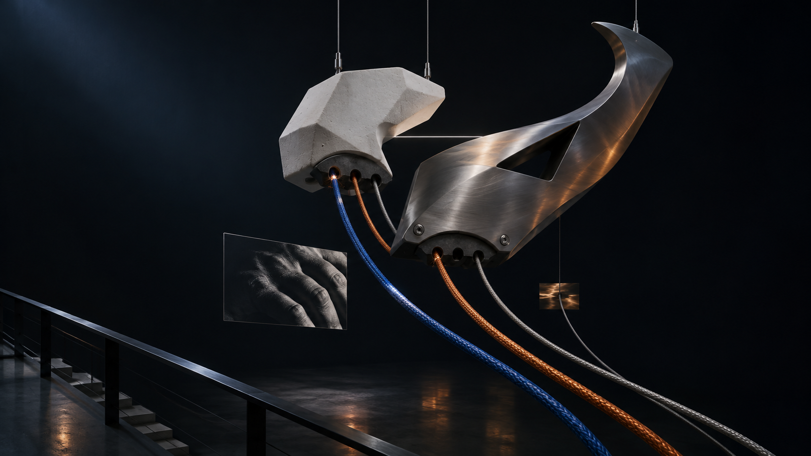
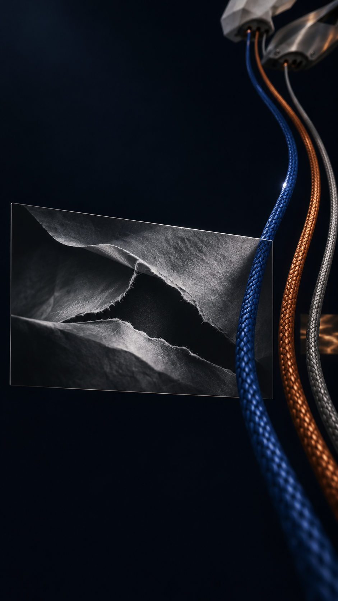
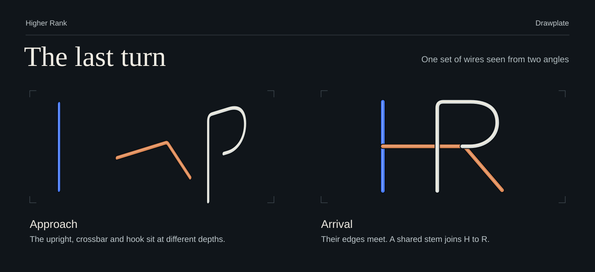

# Higher Rank · Drawplate

**Gate 1 · Creative direction for Nick’s review · November 21, 2026**

A sliver of white light hangs between two jaws, one chalk ceramic, the other hooked titanium. Three braided wires leave the gap and run out of sight. Following one takes you past moving images and down to what looks like three scraps of bent wire. Face them squarely and they spell **HR**. Scroll back an inch and the letters come apart.

*Early descent. Generated concept art for the silhouette, surfaces and lighting. The hand and amber images are placeholders. The gallery railing is incidental to the study. The proposed scene has open darkness beneath the wires.*

## The first five seconds

The first frame already has the slit, the head in three-quarter profile, the Higher Rank name, **Index**, **Contact** and a small **Follow the wire ↓** cue. One highlight slips over the ceramic lip, catches the weave of the cobalt line and disappears below frame. Visitors can follow it immediately, jump to a destination, or sit with the sculpture. At rest, the head turns a few degrees, enough for the dark triangular cut in the metal to open and close against the light.

## One descent, seven places to go

The first scroll lowers the viewpoint under the titanium shoulder. As it turns away, the nearest cable crosses a recessed media plate. For an instant you see the plate disappear behind something as thin as a wire. That single overlap tells you how much space there is to explore.

| Place along the wire | Destination | What opens |
| --- | --- | --- |
| Upper jaw · before the first turn | **Ideas & experiments** | A studio notebook for web design and digital media. Opening entry reads “First experiment pending.” |
| Middle cluster · front left | **Inspiration** | An informal invitation, “What caught your eye?” A place to bring a reference or an unfinished thought. |
| Middle cluster · rear right | **January tournament** | “An online Fortnite tournament is planned for January. Details to follow.” |
| Middle cluster · front right | **Highlights** | One screening window with three future slots for gaming or social clips. Each slot identifies the footage as pending. |
| Middle cluster · rear left | **Growth stories** | A place for channel and page histories. It opens on “Waiting for verified channel data.” |
| Lower junction · after the cluster | **Project meetings** | “Bring a project you want to make real.” Space to scope a website, an event or a digital media project with Higher Rank. |
| Final alignment · also in the index | **Start a conversation** | **Discuss Your Project** opens contact. The contact destination is marked pending until Nick supplies or verifies the route. |

The four middle plates hang in one bay. The camera first sees Inspiration and the edge of the tournament window on an opposing arc. Lower down, Highlights crosses the front while Growth comes into view behind it. At most two faces compete for attention, and one takes reading priority. The rear face becomes reachable as the camera rounds the bend. Any destination is also one direct jump away in the index.

*Portrait composition study. The tall frame gives the foreground plate reading room while keeping a continuous bundle in sight. The public-facing title and controls will sit in accessible interface text. This is concept art.*

## The last turn

A cobalt upright hangs furthest back. A copper crossbar turns down into the leg of the R. The silver hook supplies its bowl and the shared stem of both letters. The camera comes level with their ends. The last pulse traces the joins and fades. The visitor has time to recognize the mark before **Discuss Your Project** takes focus visually. Keyboard focus belongs to the visitor throughout.

The drawing uses the same three paths twice at different depths. It establishes the geometry of the idea. Whether the letters read naturally as the camera arrives still needs a moving, perspective-rendered test. The proposed mark belongs to this exploration. Nick can judge its fit with the Higher Rank identity separately.

## Moving through it

- **Scroll.** Position drives the camera, head turn and window arcs along one reversible path. A fast wheel flick or scrollbar drag goes straight to the new view. Changing direction immediately reverses the choreography. No queued tours or mandatory stops.
- **Point or tap.** Hovering a visible plate catches light on the nearest bevel and sends a short highlight down its own wire. The window stays in place. Keyboard focus gets the same emphasis and a clear outline. A single tap opens it.
- **Open and return.** A reading panel holds still while open. Close, Escape and browser Back restore the exact scroll position, active plate and opener focus. A shared destination link opens directly and closes to its named viewpoint. The index shows the current place.
- **Choose a quieter route.** Reduced motion offers composed still viewpoints and the same linked destinations. A persistent motion control pauses ambient activity. If 3D fails to start or the context is lost, a dark illustrated index retains all content, links and contact access.

## What the reference taught us

The live homepage redirected this browser to its unsupported page. I could not directly test its wheel response, pointer interaction, particle triggers or current ending. I played the January 2024 desktop walkthrough separately. Around 0:11–0:16, a small central mark holds its place amid the surrounding movement. Around 0:51 a single project surface fills the foreground. By 1:06 two faces flank the exposed structure. The changing overlap makes it easy to tell where you are. Drawplate borrows that spatial clarity. Its physical jaw, three routes, contact sparks and final letter alignment give it a different identity. [Recorded walkthrough](https://www.landing.love/sites/activetheory-2/) · [Version history](https://www.landing.love/version/activetheory/)

The founders describe keeping work and contact easy to reach. On their separate Prometheus project, the studio describes authoring start and end camera poses and tuning transitions in both directions. For Higher Rank this suggests an always-visible index and judging every camera move forward, backward and paused. Felice Varini’s account of making a form cohere from a chosen viewpoint informed the ending. [Founders’ interview](https://www.commarts.com/webpicks/active-theory-2) · [Prometheus process](https://medium.com/active-theory/prometheus-2d3c05b88ec0) · [Varini’s artist statement](https://varini.org/a-propos-de-felice-varini/)

## The first working prototype, if approved

Build just the move from the upper jaw into the first two media windows. Its deciding moment is the sightline under the titanium shoulder. The same cable must disappear into a machined opening, cross a moving image, catch a pulse and lead the eye to the next plate. Test it with a slow scroll, a fast reversal and a paused frame on desktop and portrait.

| Uncertainty | What the visual slice must establish |
| --- | --- |
| Does it still feel sculpted while idle? | Model and light the real jaw and drilled guides. Compare the metal cutout, ceramic facets, socket shadows and wire origins with the keyframe at rest. |
| Will thin braids and highlights survive movement? | Test a close crossing and the distant cables. Inspect shimmer, crushed blacks, clipped whites and visibility on a large screen. |
| Will depth and selection agree? | Pass one opaque plate behind a cable and the other in front. Try pointer, touch and keyboard. Verify open, close and restored position after reversing or dragging. |
| Can the phone carry the composition? | Stage a dedicated portrait camera, then test visible cable continuity, media decoding, portrait controls and sustained frame times. Record physical and emulated results separately. |

Deliver a local runnable revision, capture of that single move in both directions, stills at the near and far crossings, and the actual device, browser, GPU, viewport, render-buffer size and frame-time measurements wherever tested. The 4K television and Galaxy S23 Ultra remain physical test targets. The complete cluster, final camera move and real destination content belong to later gates.

**Decision requested — approve Drawplate for this visual slice, request a revision, or stop.**

[Design system](DESIGN_SYSTEM.md) · [Quality and evidence](QUALITY_CHECKLIST.md) · [Resume checkpoint](CURRENT_STATE.md)
