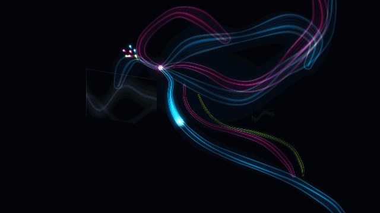
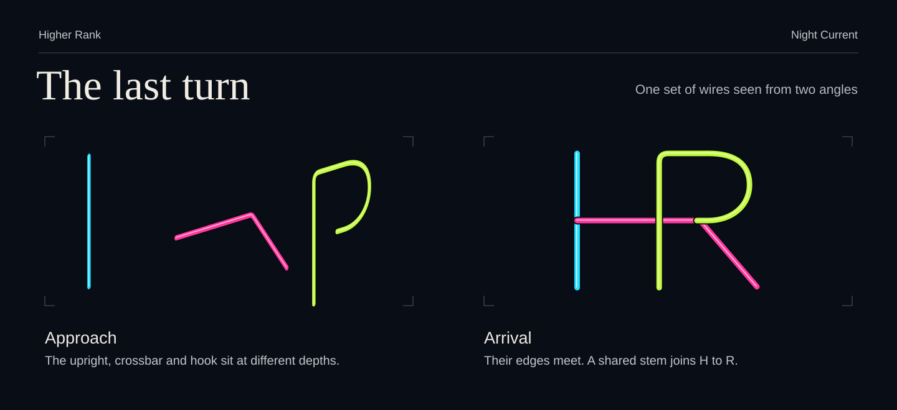

# Higher Rank · Night Current

**Gate 1 revision · CP10 · November 21, 2026**

The wires gather into a loose knot, leaving a dark opening through the middle. You can see fine lines of color through their clear skin. A hot pink pulse rounds the fold. Where the filaments touch, the charge splits. One branch throws sparks into the dark while the main cyan thread carries your eye down past the first image.

[Play the six-second current and spark study](studies/night-current/pulse.gif)

The animation is an authored timing sketch. It shows where the light moves, how long it lingers, and where the sparks originate. The accompanying wide and portrait keyframes in the conversation show the intended optical material. The still below freezes a moment after contact.

## What changed

Nick wanted more neon color and energy in the wires and found the previous treatment too industrial. The sculpture is now made from its own translucent filaments. Laser cyan carries the longest uninterrupted current. Hot fuchsia folds across it, then drops behind it. A finer citron return answers last. Each pulse has a compact, nearly white head and a longer colored wake. Uncharged stretches stay quiet enough to read each wire separately.

A contact and a crossing mean different things. Where two filaments physically touch, seven small sparks peel off on different trajectories and fade. Further down, the pink wire passes behind cyan without a discharge. The change in depth is visible even in a paused frame.

## The visitor’s path

| Place | What the visitor finds |
| --- | --- |
| Opening knot | Higher Rank, an always-available index and **Follow the wire**. **Ideas & experiments** opens from the side of the fold. |
| Middle, four suspended windows | **Inspiration**, the **planned January online Fortnite tournament**, **Highlights** with three future clip slots, and **Growth stories** when verified data is supplied. One face has reading priority as another passes behind a filament. |
| Lower junction | **Project meetings** for a website, an event or digital media. The wires begin to straighten. |
| Final viewpoint | The separate wire ends line up as **HR**. **Discuss Your Project** opens contact. Scroll back and the initials separate. |

On a phone, follow a single near cyan wire across the edge of a readable image. The fuchsia line drops behind it. The index stays within thumb reach. A tap, click or keyboard selection opens the same content. Close or Back returns to the same viewpoint and opener. Reduced motion uses the steady contact frame, direct chapter links and explicit playback.

## The decision

Judge the feel of the light, the knot when it is still, and the distinction between a contact spark and an ordinary crossing. If Nick approves this treatment, Gate 2 will model **one fold, two true depth crossings, up to two media windows and one reversible camera move**. It will include real-time lighting, a runnable local preview and motion evidence. Hardware and WebGL performance are open questions.

The walkthrough evidence and earlier spatial plan remain pinned in the prior review. [Drawplate · CP09](https://github.com/Nicknac858/ASTRA---NEW-WEBSITE---Sandbox-/blob/f8414623079619558944acf3ce40502289513053/candidates/drawplate/README.md) · [Current design rules](DESIGN_SYSTEM.md) · [Quality evidence](QUALITY_CHECKLIST.md) · [Resume checkpoint](CURRENT_STATE.md)
