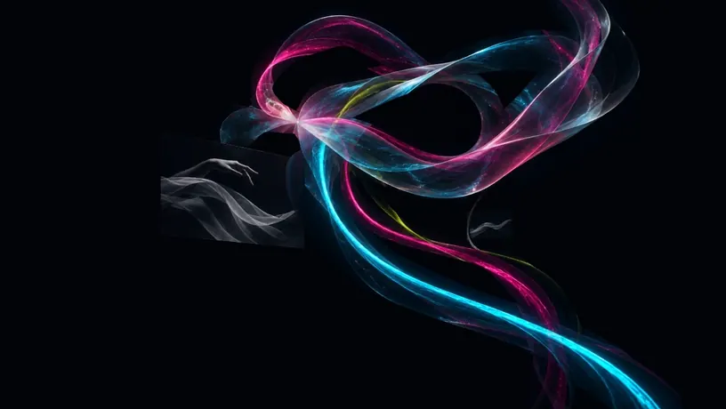

# Higher Rank · Night Current

**[Download the interactive preview](Night-Current.zip?raw=1)**

Unzip the download and open **Night-Current.html** in Chrome or Edge. It runs offline. Let the knot move for a moment, then scroll or choose **Follow the wire**. Select either suspended image to open it. **Escape** or **Close** returns you to that viewpoint. **Index** jumps between the opening and the two windows.

[Watch the seven-second MP4](Night-Current-motion.mp4?raw=1) · [Desktop view](Opening.jpg) · [Phone composition](Phone.jpg)

The film samples the working scene in Chrome using its Canvas renderer. The interactive file also includes the WebGL 2 version with curved glass surfaces, inner filaments and a depth buffer. The two windows contain concept imagery.

**For this review:** Does the light feel like it is traveling *inside* the wire, and does the knot still look like the image you approved as you scroll?
